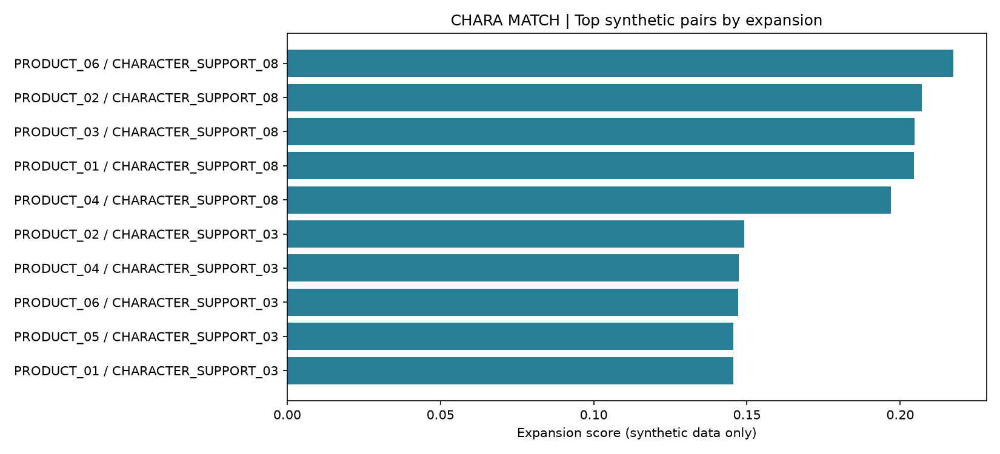

# CHARA MATCH — Portfolio Edition

**商品とキャラクターの組み合わせを、顧客構成の相性と新規層への拡張余地から比較する分析パイプライン。**

> **元データ非公開・ポートフォリオ用の一般化再実装**です。  
> 同梱データはすべて完全人工生成（fully synthetic）。元データの行・分布・集計値・設問・コード体系を再現せず、実データ由来の結果も含みません。

## 何ができるか

- 価値観に相当する人工的な連続変数を重み付きPCAとVarimax回転で要約
- 重み付きK-means++で顧客層を分け、商品購入者・キャラクター支持者の構成比を比較
- L2ロジスティック回帰のBasic／Extendedモデルを交差検証で比較
- 少数支持者の構成比を市場平均へ縮約し、相性・拡張余地・支持の上振れを算出
- 候補分類、推奨理由、クラスタ別の顧客構成差をCSVに出力

企業名、実商品名、実キャラクター名、調査固有コード、元分析の件数・項目対応表・因子解釈は収録していません。

## 分析の流れ

```text
人工データ → 加重標準化 → 次元圧縮 → 顧客クラスタ
                                  ↓
商品モデルの比較 → クラスタ別の拡張余地
                                  ↓
商品／支持者の構成比 → 縮約 → ペア評価 → 候補・理由・構成差
```

## 実行方法

Python 3.11以上。ZIPを展開し、このREADMEがあるフォルダで実行します。

```bash
python -m venv .venv
source .venv/bin/activate
python -m pip install -r requirements.txt
python -m pytest -q
python scripts/run_demo.py
```

Windowsでは仮想環境の有効化を `.venv\Scripts\activate` に置き換えてください。

デフォルトは**人工640行・12項目・6商品・8キャラクター・3成分・4クラスタ**です。
これらは公開デモのために独立して選んだ設定であり、元データの規模や構成を表しません。
全48組を計算し、`outputs_demo/` にCSV・診断JSON・グラフを保存します。

```bash
# 人工データの再生成（外部ファイルは読みません）
python scripts/generate_synthetic_data.py
# 商品・キャラクターの対象数を絞る例
python scripts/run_demo.py --n-products 2 --n-characters 3
```

## サンプル結果（人工データのみ）



[ペアの評価](outputs_sample/pair_scores.csv)にはCompatibility、Expansion、Unexpected Affinity、候補分類と推奨理由を収録しています。
[商品モデルの比較](outputs_sample/model_summary.csv)、[顧客構成差](outputs_sample/customer_shift_long.csv)も参照できます。
表示される数値は人工データによる動作例で、実際の市場についての発見ではありません。

## 変数とデータ

| 名前 | 意味 |
|---|---|
| `VALUE_ITEM_XX` | 人工的な連続価値観変数。具体的な設問との対応なし |
| `PRODUCT_XX` | 架空の購入量。正なら購入あり |
| `CHARACTER_SUPPORT_XX` | 架空の支持有無 |
| `SAMPLE_WEIGHT` | 人工的な正の重み |
| `CONTEXT_GROUP` / `CHANNEL_GROUP` | 架空カテゴリ。人口統計属性との対応なし |

詳しくは[データ辞書](sample_data/data_dictionary.csv)と[データ方針](docs/data_policy.md)を参照してください。

## スコアの解釈

- **Compatibility**：購入者と支持者のクラスタ構成比のコサイン類似度
- **Expansion**：商品側の拡張余地と、市場平均より高い支持者構成比を組み合わせた指標
- **Unexpected Affinity**：架空の背景カテゴリから推定した支持率と、購入者内の実測支持率との差
- **Customer Shift**：支持者構成比 − 購入者構成比

いずれも探索・候補比較のための指標です。売上増加や施策の因果効果を予測するものではありません。
候補分類は今回比較したペア集合の分位点に依存します。因子名・クラスタ番号に固定的な意味はありません。

## 構成

```text
src/chara_match/      分析と人工データ生成
scripts/             データ生成・デモ実行
sample_data/         完全人工データと辞書
outputs_sample/      同梱人工データから新規生成した結果
tests/              数式・入力・再現性・パイプラインのpytest
docs/               方法論・データ方針・検証記録
.github/workflows/   自動テストとデモ実行
```

詳細：[方法論](docs/methodology.md) / [再実装について](RECONSTRUCTION_NOTES.md) / [検証結果](docs/verification.md)


コードの再配布ライセンスは設定していません。
